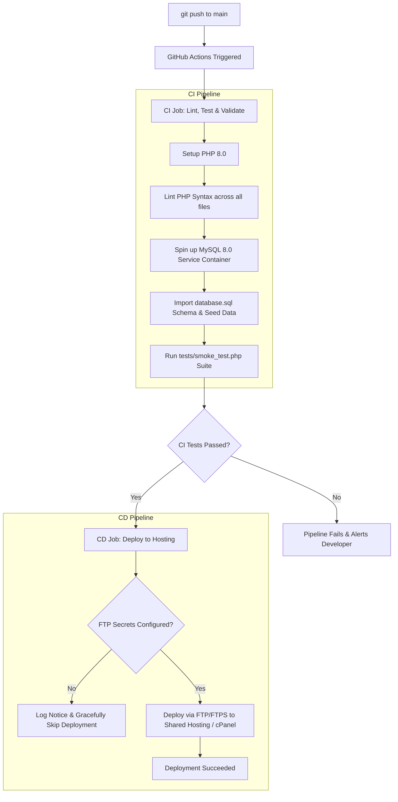

# CI/CD Deployment Guide

This document explains the Continuous Integration and Continuous Deployment (CI/CD) pipeline implemented for the **Document Request Tracking System**.

---

## 1. Pipeline Overview

The pipeline is defined in [`.github/workflows/deploy.yml`](.github/workflows/deploy.yml) and executes automatically on every `push` or `pull_request` to the `main` branch, as well as on manual trigger (`workflow_dispatch`).



---

## 2. GitHub Secrets Setup

To enable automated deployment to your shared hosting / cPanel server, add the following secrets in your GitHub repository:

1. Open your repository on GitHub: `https://github.com/ivymaejmendez/DocumentRequestTrackingSystem`
2. Go to **Settings** > **Secrets and variables** > **Actions**.
3. Click **New repository secret** for each of the following:

| Secret Name | Description | Example Value |
| :--- | :--- | :--- |
| `FTP_SERVER` | Your host FTP/FTPS server domain or IP address | `ftp.yourdomain.com` or `192.0.2.1` |
| `FTP_USERNAME` | Your FTP account username | `cpanel_user` or `deployer@yourdomain.com` |
| `FTP_PASSWORD` | Your FTP account password | `YourStrongPassword123!` |
| `FTP_SERVER_DIR` *(optional)* | Target directory on the server | `public_html/` or `public_html/document-request-system/` |
| `FTP_PORT` *(optional)* | FTP port (default: 21) | `21` |
| `FTP_PROTOCOL` *(optional)* | Protocol to use (`ftp`, `ftps`, or `ftps-legacy`) | `ftp` or `ftps` |

> [!NOTE]
> If these secrets are not yet added, the CI job will still run and test your code! The CD step will simply output a friendly notice and skip uploading until you are ready to configure the secrets.

---

## 3. Server Configuration (cPanel / Shared Hosting)

### Step 1: Database Setup
1. Log in to your hosting **cPanel**.
2. Open **MySQL Databases** or **phpMyAdmin**.
3. Create a new database (e.g. `cpaneluser_docsystem`).
4. Create a database user, assign a password, and grant all privileges on the database.
5. In phpMyAdmin, select your newly created database and click **Import**. Select [`database.sql`](database.sql) to import the tables and default accounts.

### Step 2: Production Environment (`.env`)
1. In cPanel **File Manager**, navigate to the folder where your application is deployed (e.g. `public_html/`).
2. Create a file named `.env` in the root folder (beside `index.php`).
3. Add your production database credentials:

```ini
DB_HOST=localhost
DB_PORT=3306
DB_NAME=cpaneluser_docsystem
DB_USER=cpaneluser_dbuser
DB_PASS=YourProductionDatabasePassword
DB_CHARSET=utf8mb4

APP_ENV=production
APP_DEBUG=false
```

> [!IMPORTANT]
> The `.env` file is excluded in `.gitignore` and won't be committed to GitHub. This keeps your sensitive database passwords secure and isolated from your repository.

---

## 4. Local Testing & Verification

Before pushing changes to GitHub, you can verify that everything passes locally:

### 1. PHP Syntax Check:
```bash
php -l config/database.php
```

### 2. Run Automated Smoke Tests:
```bash
php tests/smoke_test.php
```

Expected output:
```text
============================================
 Document Request System - Test Suite
============================================

Running: PHP Syntax Linting across all PHP files... [PASSED]
Running: Database Connection via config/database.php... [PASSED]
Running: Database Tables Existence Check... [PASSED]
Running: Seed Data: Admin user exists and password verifies... [PASSED]
Running: Seed Data: Document types present... [PASSED]
Running: Transactional Request Creation & Reference Number Generation... [PASSED]

============================================
 Test Results: 6 passed, 0 failed
============================================
All smoke tests completed successfully!
```

---

## 5. Excluded Files During Deployment

The automated deployment excludes development and testing files to ensure a lean and secure production environment:
- `.git/` and `.github/`
- `tests/`
- `database.sql`
- `README.md` and `CI_CD_GUIDE.md`
- `.env.example`
